# LibanPost eShop — vendor guide

For sellers on the marketplace: how to open a shop, list products, handle orders, answer reviews, get
paid, and choose how your storefront looks.

> The demonstration store already contains approved shops you can sign in as. If you create your own
> shop it will wait for staff approval before it appears in the directory — that is by design, not a
> bug.

---

## Contents

- [Opening a shop](#opening-a-shop)
- [Your dashboard](#your-dashboard)
- [Listing products](#listing-products)
- [Bulk-importing products](#bulk-importing-products)
- [Orders](#orders)
- [Returns](#returns)
- [Reviews](#reviews)
- [Payouts and commission](#payouts-and-commission)
- [Your storefront's appearance](#your-storefronts-appearance)
- [Questions vendors usually ask](#questions-vendors-usually-ask)

---

## Opening a shop

Your workspace lives at **`/Vendor`**. On first visit, if you do not yet have a shop, you are sent to
the registration form (`/Vendor/Onboarding/Register`) for your shop's name, contact details,
branding, and the **payout destination** — the account name, bank and IBAN settlements will be sent
to. All of it can be updated later; the bank details live on your payouts page.

Once submitted, the shop is **pending** until a staff member approves it at `/Admin/Shops`. On
approval your shop appears in the storefront's shop directory and your products can be published.
Staff also set your **commission rate** at that point (see [Payouts and commission](#payouts-and-commission)).
Approval, rejection, suspension and reinstatement each email the address on your account, and are
recorded on the store's audit trail.

If a shop is ever suspended, you keep your data and your workspace; only the public storefront stops
showing you. Reinstating is another staff action.

---

## Your dashboard

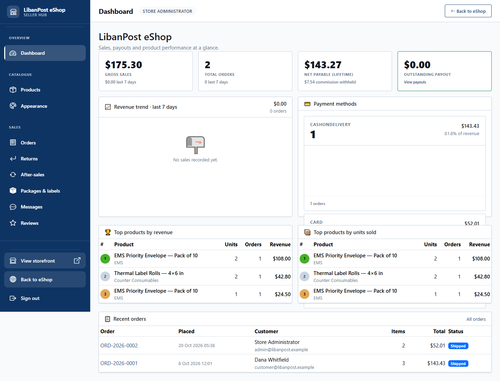


The dashboard (`/Vendor/Dashboard`) is the answer to *"how is my shop doing right now?"* at a glance:

- **Key figures** — products, orders, gross sales, and the amount currently owed to you.
- **A 30-day revenue trend** and daily figures.
- **Best-selling products** by revenue and by units.
- **Sales by payment method**.
- **Low-stock alerts** — what needs restocking before it sells out.
- **Recent orders**, linking straight into the order detail.

Every figure is scoped to **your shop only**. A brand-new shop with no sales shows an honest empty
state rather than zeros dressed up as a chart.

---

## Listing products

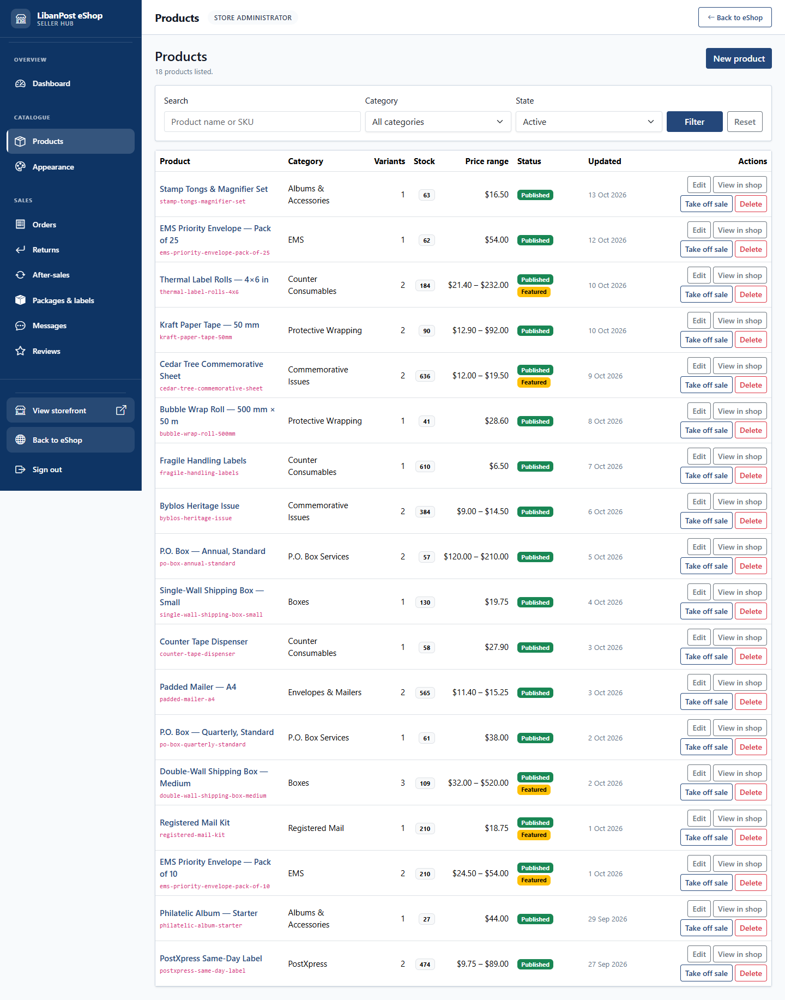

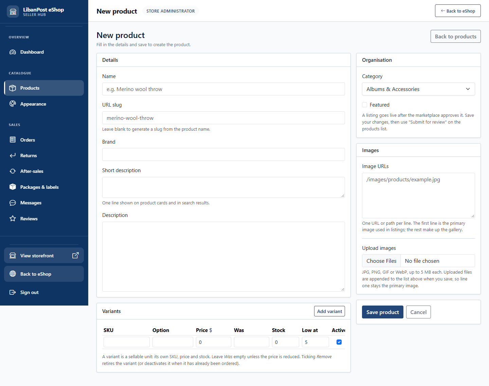

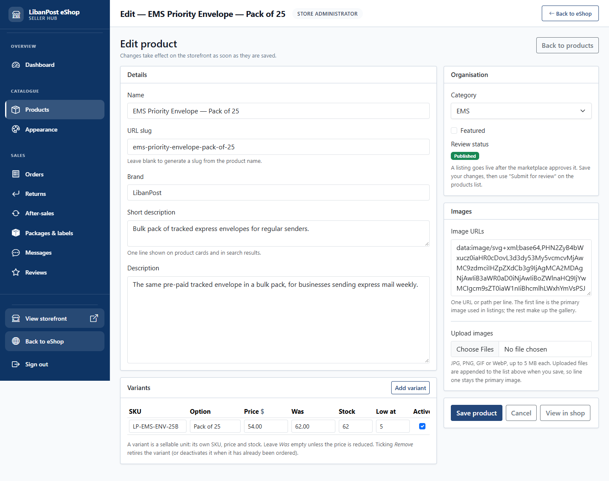


Products (`/Vendor/Products`) is your catalogue, scoped to your own shop. You can search it, filter
by category and state (active, draft, out of stock, deleted), and sort.

### Creating and editing a product

A product has:

- **Name and slug** — the slug is what appears in the web address. Leave it blank and it is derived
  from the name; it is kept unique within your shop automatically.
- **Category** — chosen from the marketplace's category tree (shared across all sellers).
- **Brand**, **short description** and **full description**.
- **Variants** — the matrix of options you actually sell. Each variant has its own **SKU**, **price**,
  optional **compare-at price** (for a struck-through sale price) and **stock quantity**. A product
  with no options still has one variant, usually named *Default*.
- **Images** — either **typed URLs** or **uploaded files**; you can mix the two. Uploaded files are
  stored by the store and appear as URLs in the same list. See the rules below.
- **Published** — a draft is invisible on the storefront. **Featured** surfaces a product in the
  storefront's featured strip.

You can **soft-delete** a product, which hides it without destroying the order history that refers to
it, and **restore** it later.

### Image rules

- Allowed types are **JPEG, PNG, GIF and WebP**. The file's actual leading bytes must match its
  extension, so renaming a script to `logo.png` is refused.
- **SVG is deliberately not accepted**, because an SVG is a document that can carry a script.
- There is a per-file size limit and a gallery limit (see the developer README for the exact numbers).
- **The first image is the primary one** — the order in the list is the order in the gallery.
- A bad upload **fails the whole save** rather than being silently dropped, and any file written
  during that failed attempt is cleaned up.
- Removing an image URL deletes the stored file, unless another product still points at the same URL.

Uploads are served from the store's own origin, so keep them to product photography.

---

## Bulk-importing products

For a large catalogue, the CSV importer is usually faster than the editor.

> **Note:** bulk import is currently a **staff** tool at `/Admin/Import`. Vendors cannot reach it
> directly; ask staff to run an import against your shop, or add products through the editor.

The importer takes a CSV file whose columns are matched **by name, so column order does not matter**.
Only `Name`, `Price` and `SKU` are required. The full header is:

```
Name,Slug,Category,Brand,ShortDescription,Description,SKU,VariantName,Price,CompareAtPrice,StockQuantity,IsPublished,IsFeatured,Images
```

Rules that matter:

- **`SKU` is the key.** An existing product is matched by SKU first, then by slug, then by name.
- **`Category` must already exist**, matched case-insensitively.
- **`Images`** is a semicolon-separated list of URLs; the first becomes the primary image.
  **Omitting the column entirely leaves the existing gallery untouched** — it does not wipe it.
  Supplying the column replaces the gallery.
- **An import is all-or-nothing.** Every row is validated before anything is written; one bad row
  rejects the whole file and reports the line. A half-loaded catalogue is worse than none.
- `IsPublished` accepts `true`/`yes`/`1`. Prices use a **decimal point** regardless of your machine's
  locale setting.

Download the template from the import page, or export your products to CSV and edit that — the
importer understands the store's own export format.

---

## Orders

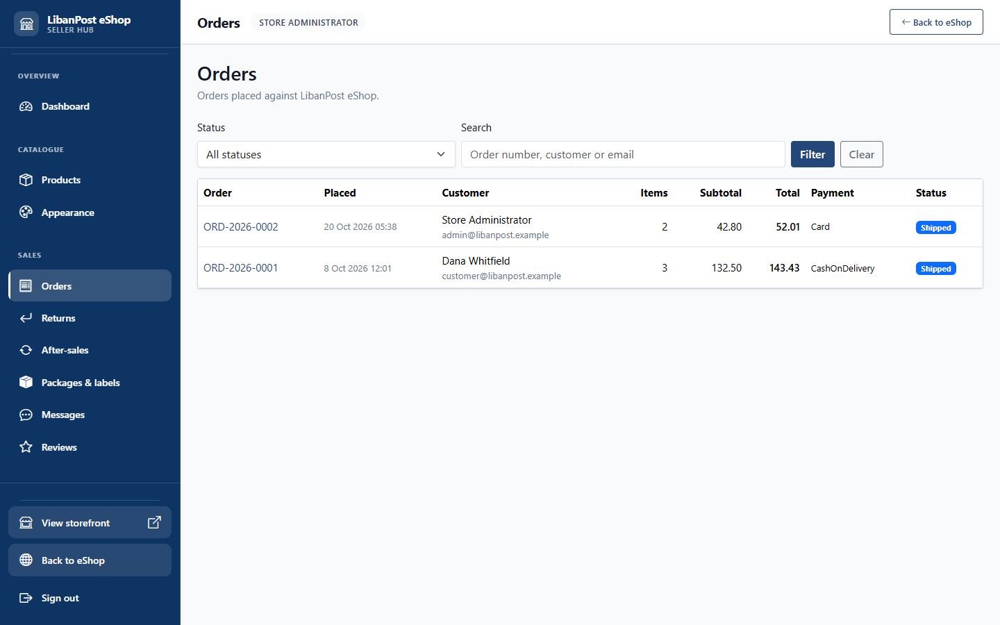

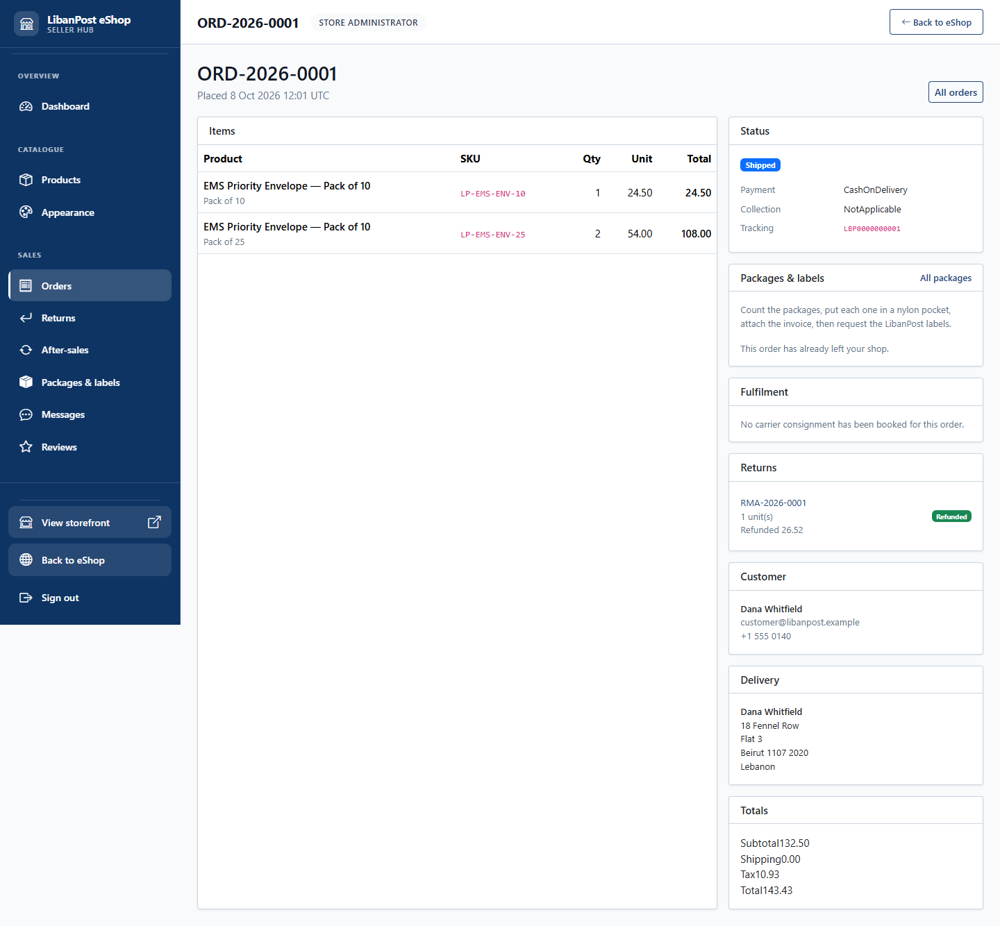

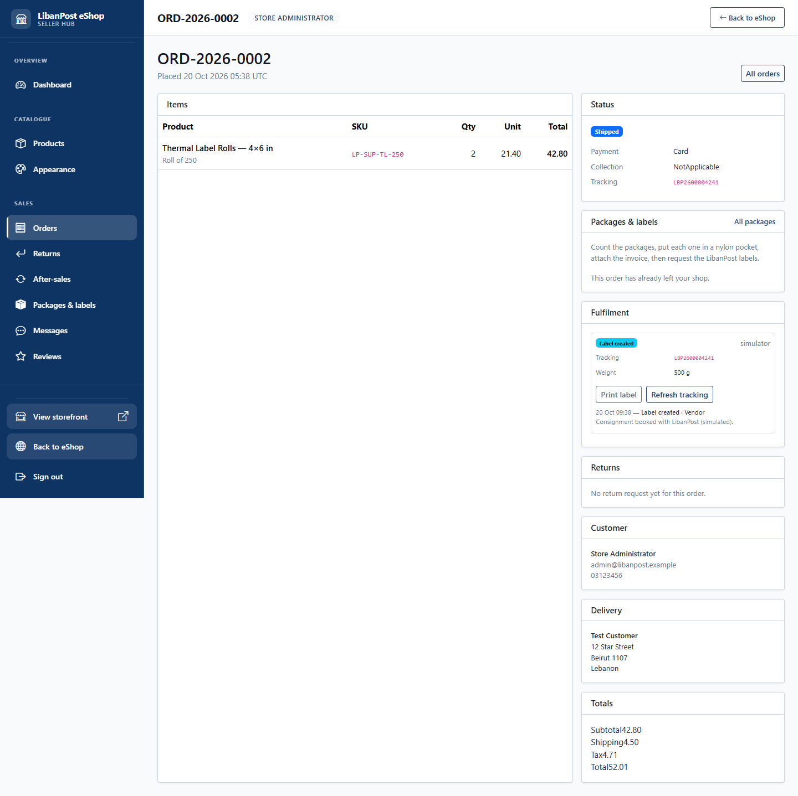


Your order book is at `/Vendor/Orders`.

- **Filter** by status, or search by order number, customer name or email.
- **Open an order** to see its items, delivery address, customer contact, totals, payment method,
  collection status and tracking number.

**Your orders only.** An order belonging to another shop returns a not-found page rather than a
redacted version of it — a vendor cannot see another vendor's order at all.

Order status is changed by **staff**, not by vendors, so that cancellations, refunds and stock
adjustments stay in one pair of hands. If you need an order cancelled or refunded, contact the store.

---

## Returns

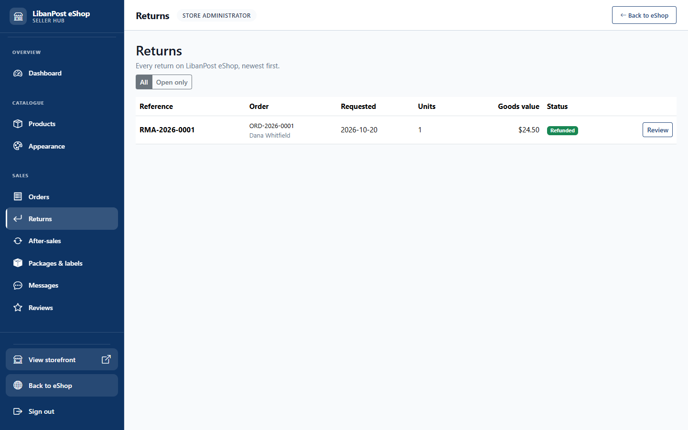

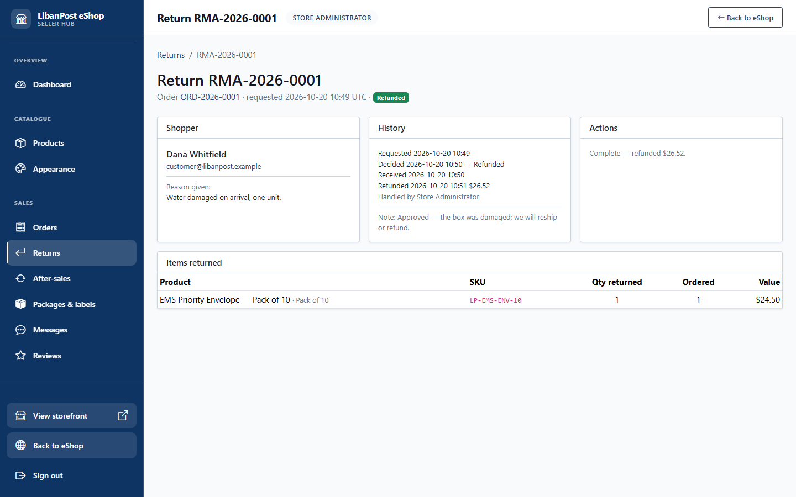


When a shopper asks to send something back, it arrives on your worklist at `/Vendor/Returns` —
`Open only` shows what needs a decision today. (A return for another shop's order is invisible; if
you open one by typing its id, you get a not-found page.)

Your part of the flow is two decisions:

1. **Decide** — open the RMA and **approve** or **reject** it, with a note the shopper sees. A
   rejection needs a reason; "received and used" reads better than silence. Approving sends the
   shopper an email telling them the goods can come back.
2. **Receive** — when the parcel returns, press **Record goods received**. The units go straight
   back onto the shelf of your listing (or the shared variant stock if the listing was removed), with
   a return-stamped entry in the stock ledger.

The customer cannot raise a second open return on the same order, and units a completed return
already refunded cannot be asked back again — the form the shopper sees enforces that, and the
server enforces it too.

What you deliberately **cannot** see or do from this page: the refund itself. Only store staff move
money, and the admin return page shows the amounts — your part is the goods and the decision, not
the payment. Every decision you make is recorded on the store's audit trail with your name on it.

---

## Reviews

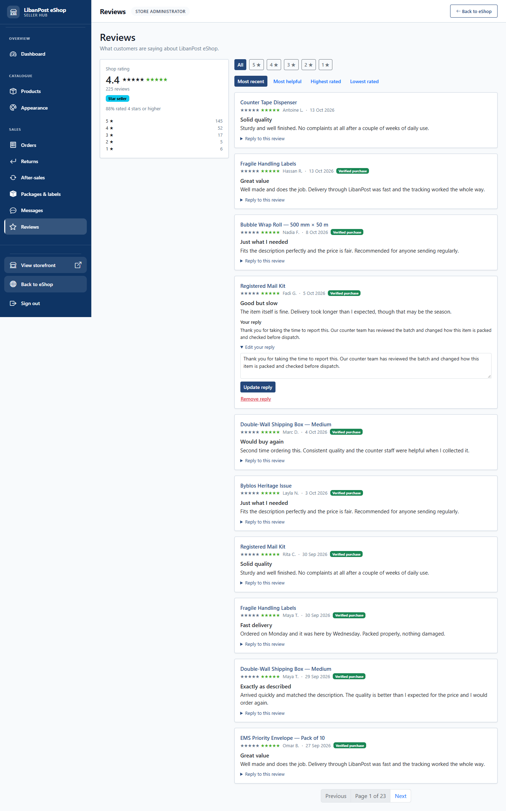


Reviews (`/Vendor/Reviews`) shows every review left against your products, along with:

- Your **aggregate score** across all published reviews.
- Your **reputation badge**, earned from that score (see the thresholds below).
- A **reply box** under each review.

**You may post one public reply per review**, and edit or clear it afterwards. A reply is the only
thing you can change — the rating and the wording belong to the customer. Replying politely to a bad
review usually reads better than not replying.

Reputation badges come from your shop's average score and review count:

| Badge | Threshold |
|---|---|
| **Star seller** | average **4.2 or better** over **5 or more** reviews |
| **Top rated seller** | average **4.5 or better** over **15 or more** reviews |

A shop that does not yet meet either threshold shows no badge. The exact numbers are configuration,
not code, so the store operator can change them. Badges appear in the shop directory, on your
storefront and in your workspace.

---

## Payouts and commission

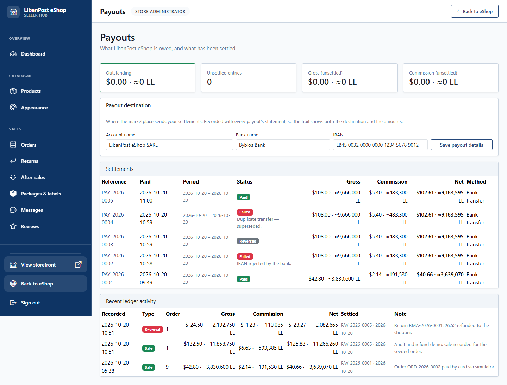

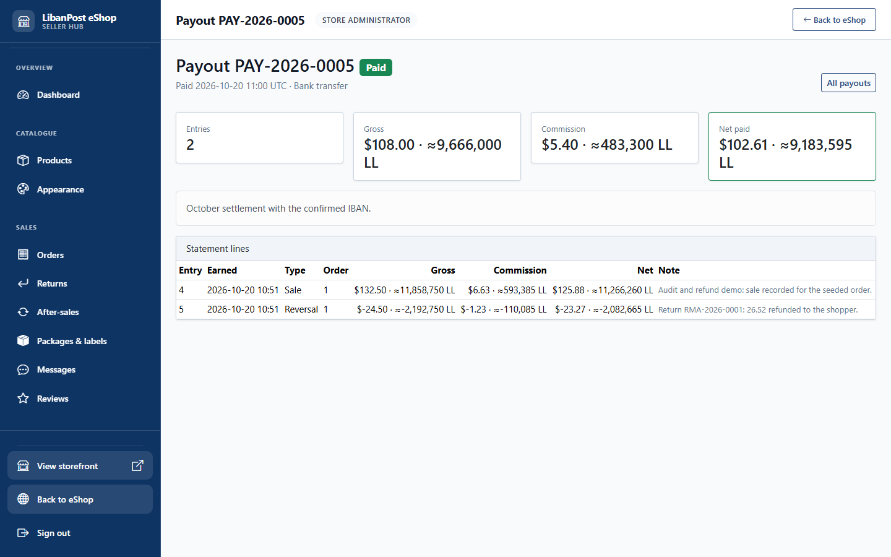


Your money page is `/Vendor/Payouts`. You see exactly what you are owed and what has been paid, and
you cannot settle yourself — staff make settlements from the admin area.

**The payout destination is yours to keep current.** The form at the top of the page records the
account name, bank and IBAN the marketplace should send settlements to; you also give these at
registration. Keep it right — anxious gaps delay money.

How the money works:

- **The marketplace holds the shopper's money** and owes you your share.
- **Commission is withheld at the gate, on goods only** — never on the shipping the carrier keeps.
  It is rounded half-away-from-zero to the cent, so a sale of $49.00 at 10% commission is
  **$44.10 net**, not "about $44".
- **You are credited when the money is actually collected**, not when the order is placed:
  - a **card** order credits when the provider confirms capture,
  - a **cash-on-delivery** order credits when the carrier holds the cash at delivery,
  - a **counter** payment credits when staff mark it paid.
- **A cancellation or refund reverses the credit**, taking the earning back.
- **Crediting happens exactly once.** A redelivered payment message or a double-clicked button cannot
  pay you twice.

**What you are owed is never a stored number.** Your balance is always the sum of your *unsettled*
earnings, so it cannot drift away from the orders and refunds behind it. A **settlement** merely marks
the earnings it covers as settled and gives you a statement — reference, period, and the gross,
commission and net figures — which you can download as CSV or Excel.

**Settlements carry their outcome on their face.** Each row in your history shows a badge:

- **Paid** — the transfer is done.
- **Failed** — the bank refused it. The reason the staff member recorded is shown on the row, and
  every earning it covered is back on your balance for the next settlement; you lose nothing.
- **Reversed** — staff recorded the settlement in error (for example a duplicate); the covered
  earnings return to your balance likewise. A reversed settlement keeps its totals for the record —
  the figure is corrected by another row, never by rewriting the statement.

You are emailed each time a settlement is recorded (if the store has a contact email for your shop).

One edge case worth knowing: if a refund lands **after** a settlement has already paid you, your
balance goes negative and stays negative until new sales cover it. That is the correct accounting, not
an error.

Your net is never paid out below the store's minimum-settlement amount; small balances may be batched
until they are worth a transfer.

---

## Your storefront's appearance

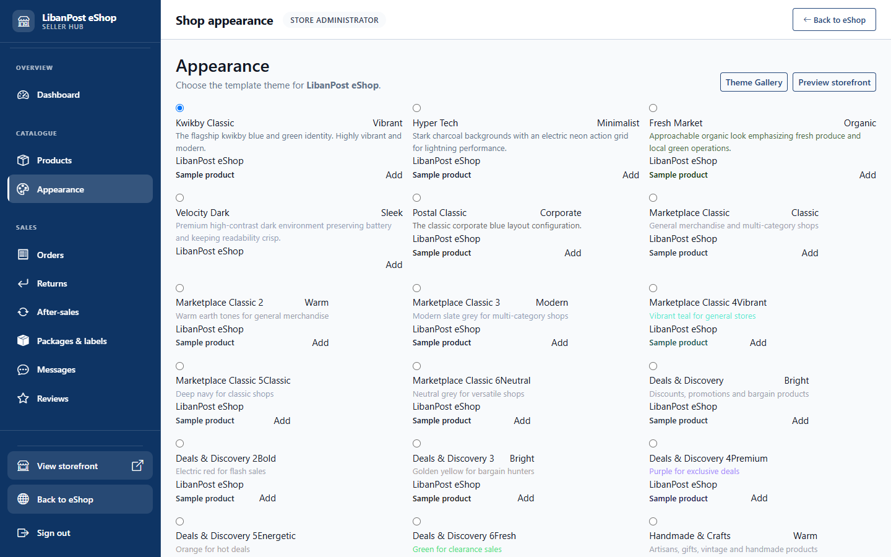


Every shop gets its own themed storefront. Choose the template at `/Vendor/Appearance`.

Six templates are available, each previewed live on the page before you apply it:

| Template | Character |
|---|---|
| **Postal Classic** | The house palette — blue and yellow. The default. |
| **Midnight** | Dark. |
| **Sunrise** | Warm and light. |
| **Boutique** | Elegant, with serif headings. |
| **Forest** | Natural, green. |
| **Mono** | Minimal, black and white. |

Changing the template re-skins the whole storefront — header, product cards, buttons and footer —
without touching a single product. Your catalogue is unaffected.

A template that is somehow unknown falls back to the default rather than rendering an unstyled page,
so your storefront is never broken by a misconfiguration.

---

## Questions vendors usually ask

**How do I become a vendor?**
Register a shop at `/Vendor/Onboarding/Register`; staff approve it and set your commission.

**My product is saved but not visible.**
Check that it is **published**, not a draft, that it has a **variant with stock**, and that your shop
is **approved** rather than pending or suspended.

**Why can I not change an order's status?**
Status changes are staff-only, deliberately — they carry stock and refund consequences. Ask the store.

**Why has my balance not been paid?**
Either the money has not been collected yet (a card order is credited on capture, a cash-on-delivery
order at delivery), or the balance is below the store's minimum-settlement amount, or it is negative
because a refund landed after a settlement.

**Why does my balance show less than my sales?**
Commission is withheld, and only on goods — not on shipping. The payouts page breaks the figure down
into gross, commission and net.

**Can I edit or delete a customer's review?**
No. You may post one public reply. The rating and wording are the customer's.

**Can I see another shop's orders?**
No. Your workspace is scoped to your own shop, and another shop's order is a not-found page. The same
rule covers another shop's returns.

**A shopper asked to return an item — what do I owe them?**
Nothing yet. Approve or reject it on `/Vendor/Returns`. Once the goods are back and staff record the
refund, the refund amount comes off what the marketplace owes you (or your balance, if the refund
lands after a settlement) — see the reversal rules under *Payouts and commission*.

**My imported file was rejected and nothing changed.**
That is intended: an import is all-or-nothing. The page lists the exact lines that failed. Fix them
and upload the file again.

## Additional screens

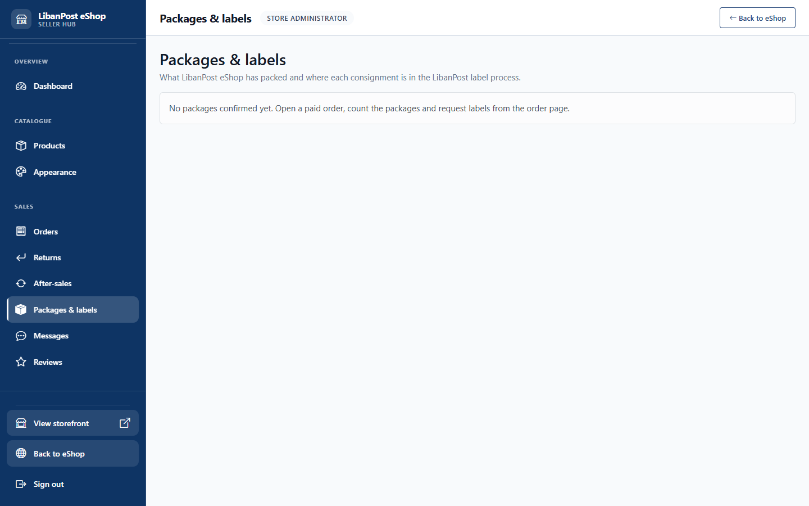

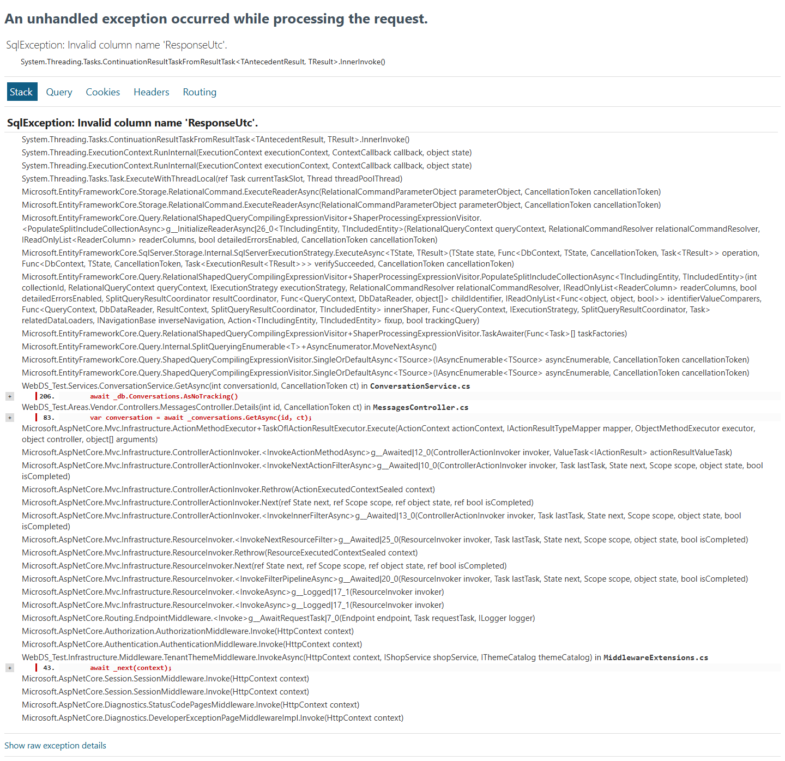

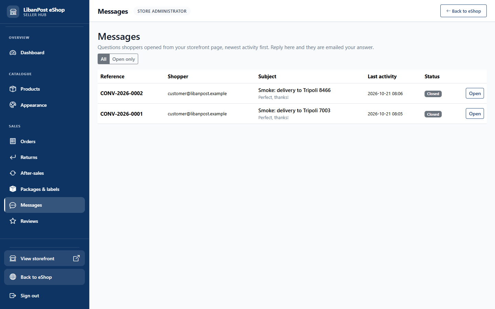

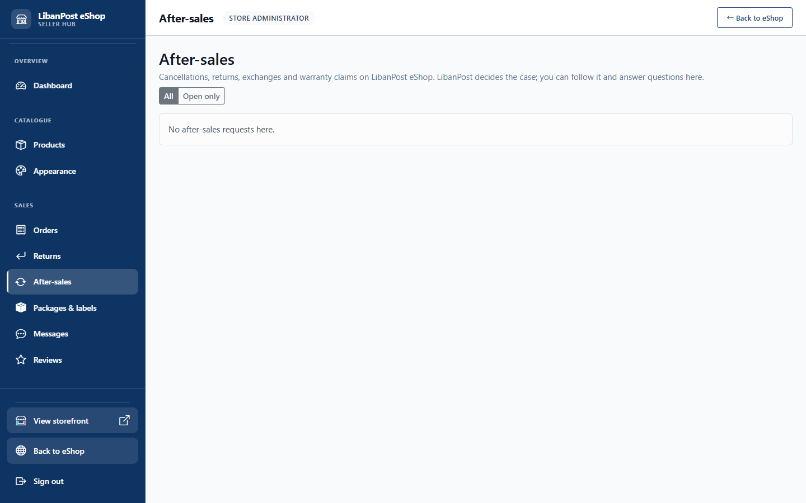

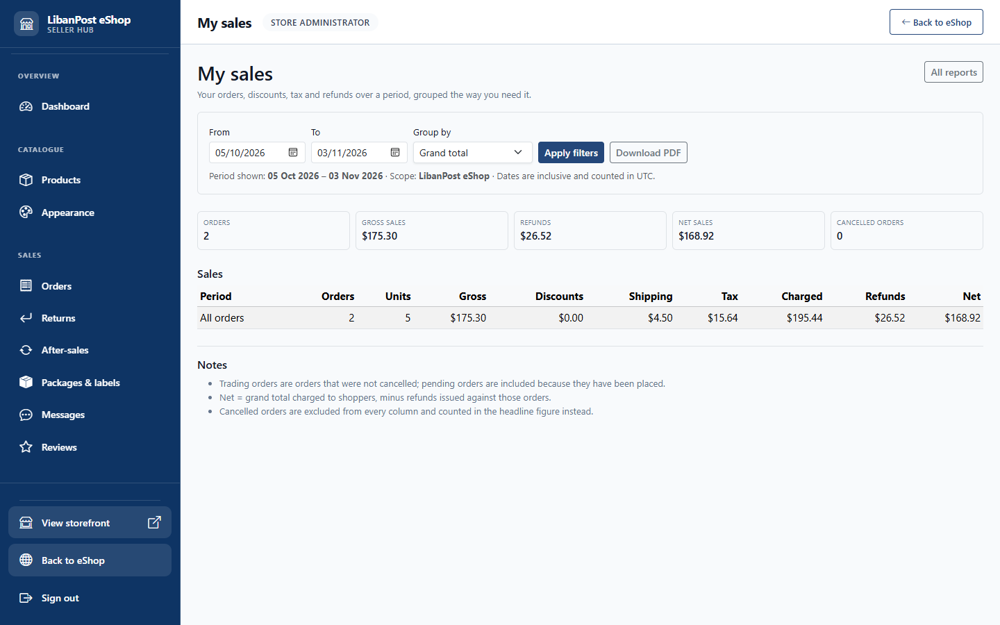

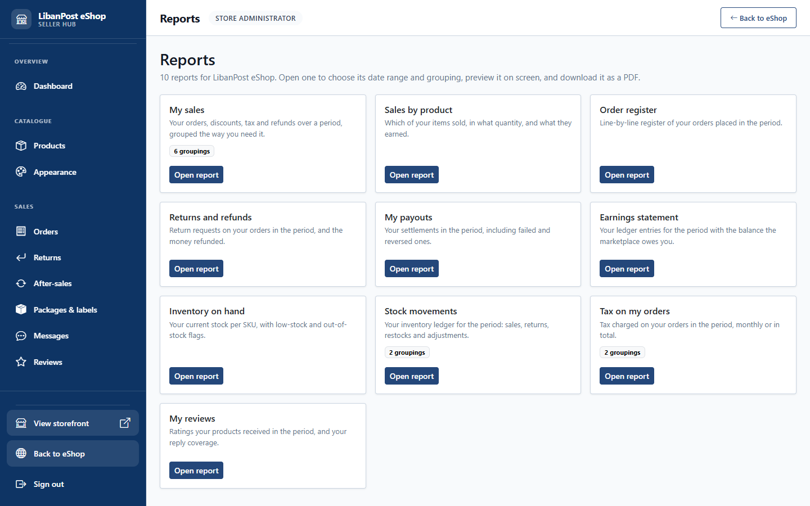

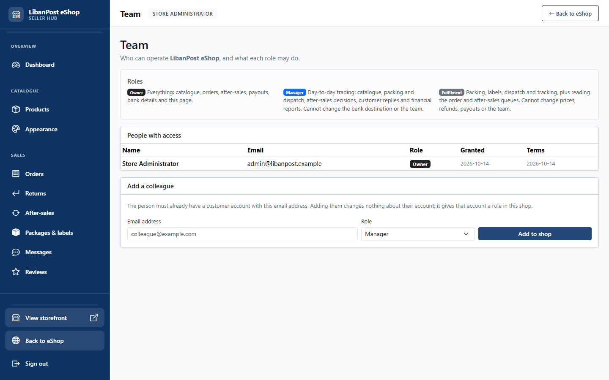

---

# Seller (vendor) form and field reference

## 6. Vendor area (`/Vendor`)

### Shop onboarding — `/Vendor/Onboarding/Register` (`Onboarding/Register`)
- **Model:** `ShopRegistration`
- **Form:** one `POST` form (`Onboarding/Register`).
  | Field | Type | Purpose |
  |---|---|---|
  | `Name` | input | Shop name. |
  | `Tagline` | input | Short tagline. |
  | `Description` | textarea | Shop description. |
  | `PickupLocation` | input | Where the courier collects parcels. |
  | `BankAccountName` | input | Payout destination — account holder. |
  | `BankName` | input | Payout destination — bank. |
  | `BankIban` | input | Payout destination — IBAN. |
  | `ThemeKey` | select | Storefront template. |
  | `AcceptTerms` | checkbox | Accept terms. |
- Reapplying a rejected application pre-fills every field, the payout details included.

### Vendor dashboard — `/Vendor/Dashboard` (`Dashboard/Index`)
- **Model:** `ShopDashboard`. No forms.

### Vendor products list — `/Vendor/Products` (`Products/Index`)
- **Model:** `AdminProductListViewModel` (shared)
- **Forms:** four (same as admin products list: filter, toggle published, restore, delete).

### Vendor product edit — `/Vendor/Products/Edit` (and Create) (`Products/Save`)
- **Model:** `ProductEditViewModel` (shared)
- **Form:** one `POST` form (`Products/Save`), `enctype="multipart/form-data"` — same fields as the admin product edit form.

### Vendor orders list — `/Vendor/Orders` (`Orders/Index`)
- **Model:** `IReadOnlyList<Order>`
- **Form:** one `GET` filter form — `status` (select), `q` (search).

### Vendor order detail — `/Vendor/Orders/Details/{id}` (`Orders/Details`)
- **Model:** `Order`. Read-only except for dispatch: the shop can register its own shipments
  through the simulator. Returns against the order appear in their own panel, linking to the RMA
  detail where the shop acts on them.
- **Forms:** two (`POST`) — **Ship** (`Orders/Ship`) and **Refresh tracking** (`Orders/RefreshTracking`),
  each just `id` (hidden). Status changes beyond shipping stay staff-only.

### Vendor returns — `/Vendor/Returns` (`Returns/Index`)
- **Model:** `IReadOnlyList<ReturnRequest>` (the shop's own only; another shop's is a `404`).
- **Form:** none — two filter links (`All` / `Open only`) and **Review** buttons into the detail.
- Columns: reference, order, requested, units, goods value, status badge.

### Vendor return detail — `/Vendor/Returns/Details/{id}` (`Returns/Details`)
- **Model:** `ReturnRequest`.
- **Purpose:** The worklist decision: approve or reject the request (with a note the shopper will
  see), then record the goods as received when the parcel arrives. Restocked units show up in the
  shop's stock ledger. The refund itself is staff-only and never shown here.
- **Forms:** three (`POST`).
  1. **Approve** (`Returns/Decide`) — `approve=true` (hidden), `note` (textarea).
  2. **Reject** (`Returns/Decide`) — same shape, `approve=false`.
  3. **Receive goods** (`Returns/Receive`) — no fields; restocks and closes the handing-back step.

### Vendor reviews — `/Vendor/Reviews` (`Reviews/Index`)
- **Model:** `VendorReviewListViewModel`
- **Forms:** two (both `Reviews/Reply`, POST).
  1. Write reply — `reviewId`, `stars`, `sort`, `page` (hidden), `reply` (textarea).
  2. Clear reply — `reviewId`, `reply` (hidden, empty), `stars`, `sort`, `page` (hidden).

### Vendor payouts — `/Vendor/Payouts` (`Payouts/Index`, `SaveBank`)
- **Model:** `VendorPayoutViewModel`.
- **Balance and settlements are read-only.** Every settlement shows its status badge (`Paid`,
  `Failed`, `Reversed`), and failed or reversed rows explain why (reason, who handled it, when).
- **Form:** one `POST` form (`Payouts/SaveBank`) — the payout destination the marketplace will use:
  | Field | Type | Limits |
  |---|---|---|
  | `bankAccountName` | input | ≤ 120 chars; account holder. |
  | `bankName` | input | ≤ 120 chars. |
  | `bankIban` | input | ≤ 40 chars. |

### Vendor payout detail — `/Vendor/Payouts/Details/{id}` (`Payouts/Details`)
- **Model:** `VendorPayoutDetailViewModel`. No forms; the statement plus its status — a `Failed` or
  `Reversed` settlement shows the reason and who marked it so.

### Vendor appearance — `/Vendor/Appearance` (`Appearance/Index`)
- **Model:** `ShopAppearanceViewModel`
- **Form:** one `POST` form (`Appearance/Index`).
  | Field | Type | Purpose |
  |---|---|---|
  | `themeKey` | radio | Chosen storefront template (one of six). |

---

---

# Common buttons and what they do (plain language)

| Button / action | What it does |
|---|---|
| **Save / Create / Add** | Writes the form to the database. If a required field is missing, the page re-opens with a red message and nothing is saved. |
| **Cancel** | Throws away what you typed and returns to the previous page. No data is saved. |
| **Edit / pencil icon** | Opens the same record in an editable form. |
| **Delete / trash icon** | Removes the record. Where deletion would break history (orders, coupons already used, tax classes in use) the store deactivates instead, so old references keep working. |
| **Search / Filter** | Re-runs the list with the chosen filters. Filters live in the web address, so you can bookmark or share a filtered view. |
| **Export CSV / Export Excel** | Downloads the current filtered list as a file. |
| **Publish / Unpublish** | Shows or hides a product on the storefront. Drafts stay invisible. |
| **Approve / Reject** | Decides a pending shop application or return request. Reject needs a reason, which the customer sees. |
| **Suspend / Reinstate** | Takes a shop off the storefront (keeping its data) or brings it back. |
| **Pay out** | Settles a vendor's whole outstanding balance and produces a downloadable statement. |
| **Mark failed / Reverse** (payouts) | Records that a bank transfer did not go through (with the bank's reason) or was recorded in error. Releases the covered earnings back to the unpaid balance. |
| **Issue refund** | Computes and records a refund for a received return. Only store staff can do this. |
| **Record goods received** | Puts returned units back on the shelf and writes a return-stamped stock movement. |
| **Resend** (emails) | Returns a failed email to the queue with a clean history. |
| **Send test** | Queues a test message to confirm email configuration. |
| **Toggle wishlist / heart** | Adds or removes a product from your wishlist. |
| **Request a return** | Opens the return form for an order. |
| **Cancel request** | Withdraws a return you raised, before the goods are received. |

